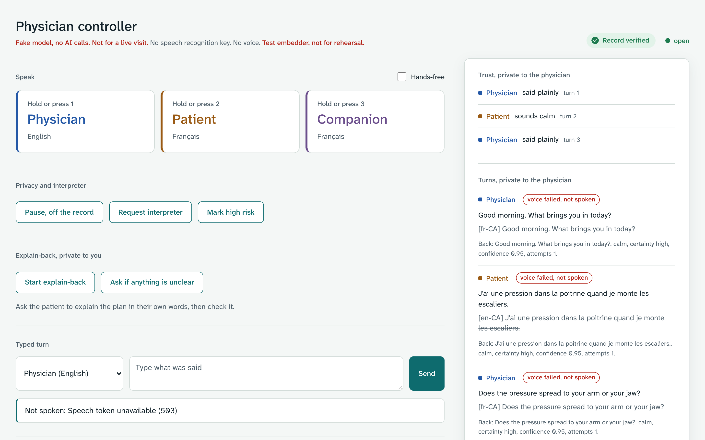
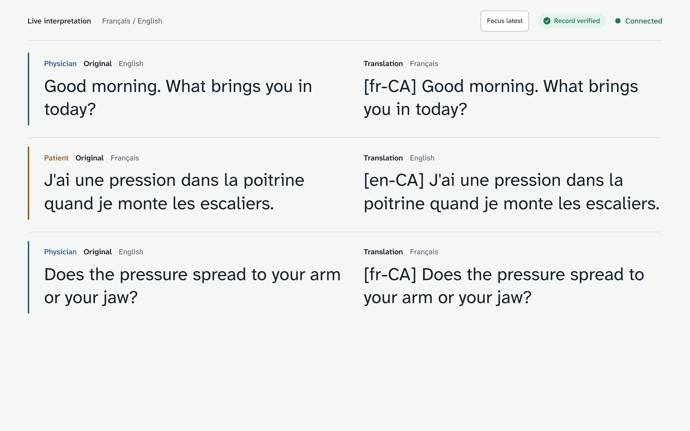
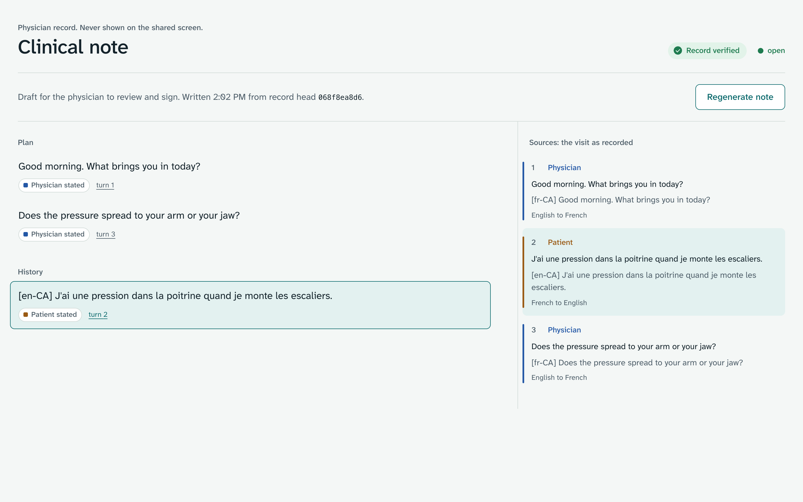
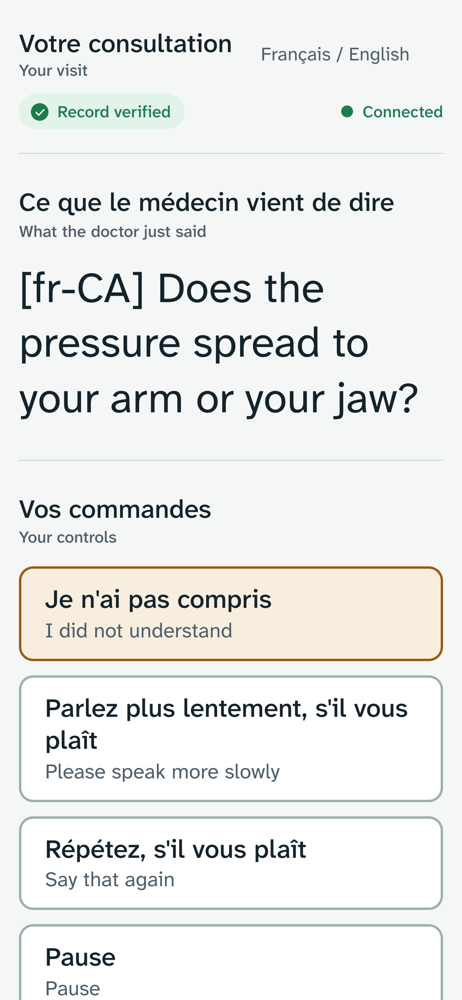
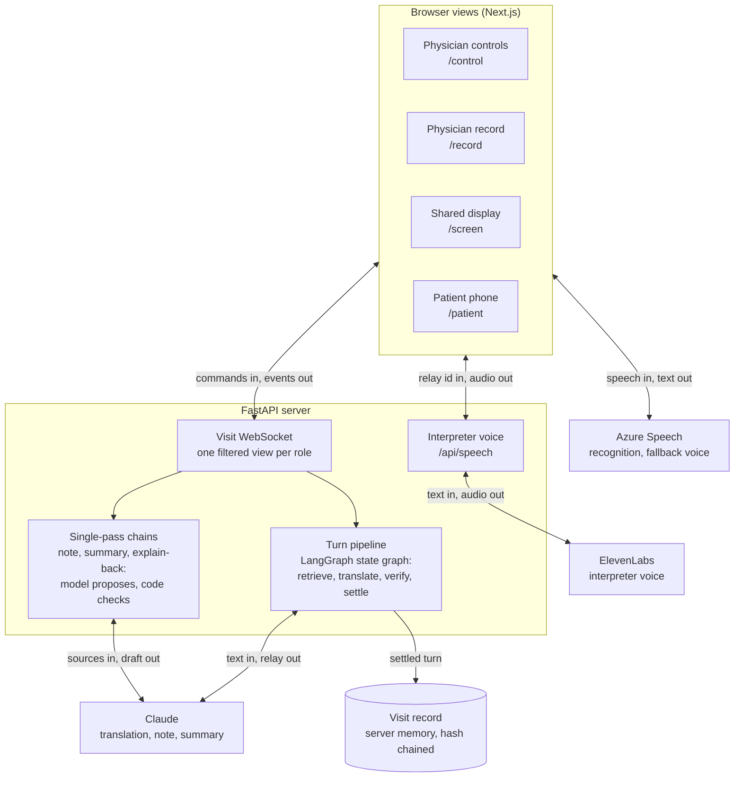
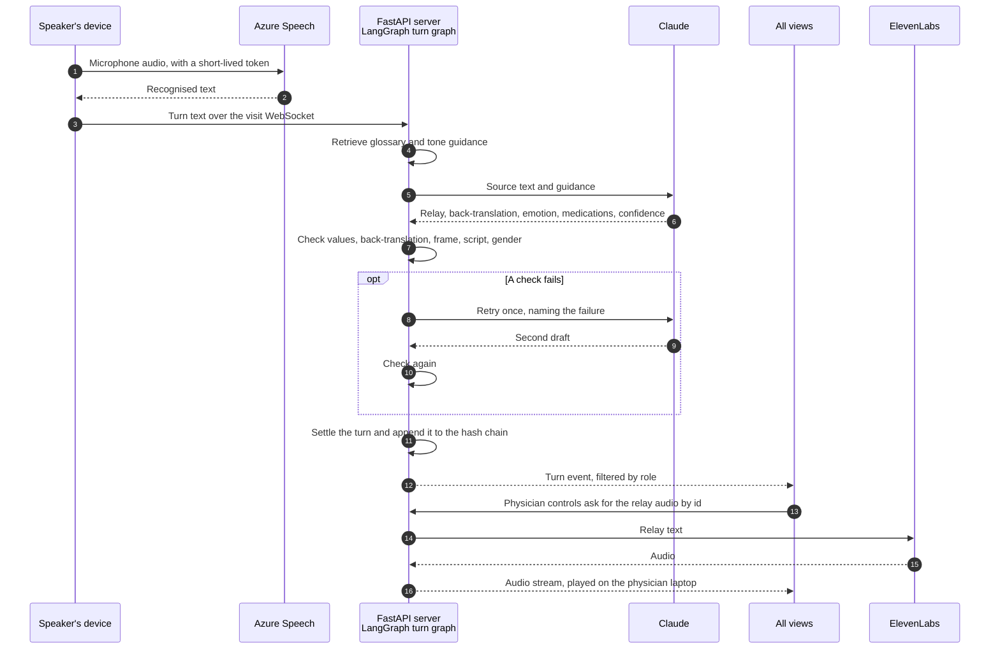

# Patient-Physician Transcriber

A demo prototype of an AI medical interpreter for a patient and physician who speak different languages.
It captures one speaker at a time, shows the original and interpreted text on a shared screen, and reads the interpretation aloud.
The patient can ask for clarification in their own language, and the physician can check medication values before the relay plays.

It uses fictional consultations and is not for clinical use.
The [English and Canadian French demo script](docs/demo-night-english-french-voice-script.md) has voice lines and cues for each screen.

## Screenshots

<table>
  <tr>
    <td width="50%" valign="top">
      
      <br><sub><b>Physician controls</b> (<code>/control</code>)</sub>
    </td>
    <td width="50%" valign="top">
      
      <br><sub><b>Shared display</b> (<code>/screen</code>)</sub>
    </td>
  </tr>
  <tr>
    <td width="50%" valign="top">
      
      <br><sub><b>Physician record</b> (<code>/record</code>)</sub>
    </td>
    <td width="50%" valign="top" align="center">
      
      <br><sub><b>Patient phone</b> (<code>/patient</code>)</sub>
    </td>
  </tr>
</table>

These screenshots come from the credential-free smoke test described in [Run locally](#run-locally).
The fake translator echoes each turn with a language marker such as `[fr-CA]`, and the physician controls show the warnings the app raises when it has no model or voice keys.

## For reviewers: where to start

1. Read [AGENTS.md](AGENTS.md).
   It explains how the repository is built and how a human gates every decision.
2. Skim the [decision registry](openspec/tdr/index.md), then open [ADR-004](openspec/tdr/adr/adr-004-langgraph-turn-graph.md) for the turn pipeline and [CDR-001](openspec/tdr/cdr/cdr-001-visit-websocket-events.md) for the WebSocket contract.
3. Run it without credentials using the fake translator, as described in [Run locally](#run-locally), and enter a typed turn on `/control`.
4. Run the checks listed in [Development and verification](#development-and-verification).
5. Read the code that matters most:
   - [`server/graph/turn_graph.py`](server/graph/turn_graph.py) is the per-turn pipeline: retrieve, translate, verify, then settle, with one retry.
   - [`server/critical_values.py`](server/critical_values.py) is the code that compares medication values across languages.
   - [`server/chains/`](server/chains) holds the note, summary, and explain-back chains and their provenance checks.
   - [`server/main.py`](server/main.py) is the FastAPI app and the role-filtered visit WebSocket.
   - [`server/hash_chain.py`](server/hash_chain.py) is the hash chain behind the record badge.
   - [`web/e2e/`](web/e2e) holds the Chromium rehearsals and regressions.
6. Finish with [Where it needs more tuning](#where-it-needs-more-tuning) and [known gaps](docs/known-gaps.md) for the limits we know about.

## What you can try

| Feature | What the demo shows |
| --- | --- |
| Bilingual conversation | Push-to-talk for physician, patient, and companion, with speaker labels, side-by-side captions, and spoken interpretation. |
| Consent and pause | The patient can accept the notice in their language, pause the visit, and resume from their own device. |
| Transcript review | A low-confidence push-to-talk capture can be reviewed on the physician screen before translation. For patient speech, the patient can privately confirm what they said or choose to repeat it. |
| Patient controls | The patient can ask for a simpler explanation, slower speech, or a repeat. The physician sees the request during the visit. |
| Medication checks | The app compares detected critical values before release. It holds back a mismatch and asks the physician to confirm a matching medication instruction when read-back is required. The Presenter controls can simulate a mismatch. |
| Human interpreter | Either participant can request an interpreter. The connection is simulated in the demo. |
| Explain-back and review | The physician can ask the patient to explain the plan in their own words. The patient can review or correct settled transcript entries, with the original retained in the visit history. |
| Visit outputs | The app can generate a physician note with source links and a patient-language summary. The record badge reflects the integrity of the current visit’s hash chain. |

English is the physician language.
Canadian French, Punjabi, and Tamil are selectable patient languages.
Sinhala is available in test mode, and other listed languages are roadmap entries.
Language availability and rehearsal evidence are tracked in the [speech test log](docs/speech-test.md).

## How it works

The first diagram shows the parts and who talks to whom.
Every arrow to an outside service is a request with a reply: the reply always returns to the caller, never onwards to another service.



The second diagram follows one spoken turn from the microphone to the loudspeaker.



Each view is a separate Next.js page.
The physician controls and the record connect to the server as the `controller` role, the patient phone connects as the `review` role, and the shared display connects as the `screen` role.
The server sends each role only what it may see, and it refuses commands from the wrong role.
Speech recognition runs in the browser with short-lived Azure tokens minted by the server, so the speech keys never reach a device.

The turn pipeline is a LangGraph state graph (ADR-004) with four steps: retrieve, translate, verify, and settle.
The note, summary, and explain-back are single-pass chains that each call Claude once.

A finished capture goes to the turn pipeline, which retrieves glossary and tone guidance from a local knowledge base, asks Claude for a translation, and then verifies it in code.
The checks compare medication values across languages, look for a lost or altered value, and test the back-translation, the reporting frame, and the script.
A failed attempt is retried once.
A turn that still fails is blocked, marked unclear, or escalated to the simulated human interpreter.
Claude's reply never goes straight to a device: it returns to the server, is checked, and only then is sent to the views.
A turn settles as final, read-back required, blocked, unclear, or escalated, and only a turn that may be spoken has audio.
The interpreter voice is the server's ElevenLabs voice, which the physician controls ask for by id, and the browser's Azure voice speaks only when the server has no voice for the language or the vendor fails.
The note, patient summary, and explain-back check use frozen sources: the model proposes, and code checks provenance and values.
Visit state is in memory (ADR-007).

## Repository map

| Path | What lives there |
| --- | --- |
| `web/` | Next.js front end. Routes are in `web/app/` (`control`, `screen`, `patient`, `record`), views in `web/components/`, the WebSocket client, speech client, and contract types in `web/lib/`, and Chromium rehearsals in `web/e2e/`. |
| `server/` | FastAPI back end. `main.py` is the app and visit WebSocket, `graph/` the LangGraph turn pipeline, `chains/` the note, summary, and explain-back chains, `critical_values.py` the value comparison, `hash_chain.py` the record integrity chain, `kb/` the knowledge base, and `tests/` the pytest suite. |
| `openspec/` | Behaviour. `specs/` holds accepted specs, `changes/` holds each change with its proposal, design, specs, and tasks, and `config.yaml` holds the rules for artifacts, apply, and archive. |
| `openspec/tdr/` | Decisions. One folder per record type, the [registry](openspec/tdr/index.md), the [guide](openspec/tdr/README.md), and the templates. |
| `docs/` | The [demo scripts](docs/demo-night-english-french-voice-script.md), the [speech test log](docs/speech-test.md), the [known gaps](docs/known-gaps.md), and product research. |
| `scripts/` | `dev.sh` starts the server and web app together, and `check_tdr.py` validates the decision records. |
| `.github/pull_request_template.md` | The pull request checklist for OpenSpec tasks and decisions. |
| `AGENTS.md` | The working rules for agents and humans. `CLAUDE.md` points to it. |

## How it is built

The repository uses spec-driven development with [OpenSpec](openspec/changes) and Decision-Driven Software Engineering.
AI agents do most of the building, and a human accepts every decision and reviews the work.
Behaviour is specified in OpenSpec changes and specs.
Decisions are recorded as Technical Decision Records of six types: MDD for product and methodology, ADR for architecture, CDR for contracts, EDR for engineering practice, IDR for implementation choices, and TDM for temporary choices with an expiry.
An agent may draft a record as `proposed`, but only a human can accept it, and a task may start only when every record it lists is accepted.
`scripts/check_tdr.py` checks the records and the registry and reports which task groups are blocked.
Governed code carries `@implements` annotations, and commit messages cite record ids.

See [AGENTS.md](AGENTS.md) for the loop and the roles, the [decision registry](openspec/tdr/index.md) and its [guide](openspec/tdr/README.md) for the records, and the [pull request template](.github/pull_request_template.md) for what a reviewer is asked to check.

## Run locally

You’ll need Python 3.12 or newer, [uv](https://docs.astral.sh/uv/), Node.js 22 or newer, and Chrome for microphone capture.

```bash
cp server/.env.example server/.env
(cd server && uv sync && uv run python scripts/download_model.py)
(cd web && npm ci)
```

Set `ANTHROPIC_API_KEY`, `AZURE_SPEECH_KEY`, and `AZURE_SPEECH_REGION` in `server/.env`.
For ElevenLabs playback, set `ELEVENLABS_API_KEY` in the root `.env.local` or in `server/.env`.
Azure also supplies fallback playback.
The first run downloads the multilingual embedding model.

```bash
(cd server && uv run python scripts/check_keys.py)
scripts/dev.sh --prod
```

Use `scripts/dev.sh` without `--prod` for development.
The startup log identifies the translator, recognition provider, voice, and embedding model.

| View | URL |
| --- | --- |
| Physician controls | `http://localhost:3000/control` |
| Shared display | `http://<laptop-ip>:3000/screen` |
| Patient phone or tablet | `http://<laptop-ip>:3000/patient` |
| Physician record | `http://localhost:3000/record` |

Put the demo devices on the same Wi-Fi.
Use the laptop address printed by the startup script for the TV and patient device.
On the physician screen, choose the patient language, show the consent notice, and wait for consent before using the speaking controls.

For a credential-free smoke test, run `TRANSLATOR=fake EMBEDDINGS=hashing scripts/dev.sh --prod` without live service keys and enter a typed turn.
Fake translation echoes the input with a language marker and can exercise the app flow without a live translation.

## Development and verification

```bash
python3 scripts/check_tdr.py
(cd server && uv run ruff check . && uv run ruff format --check . && uv run pytest)
(cd web && npm run lint && npm test && npm run check:contracts && npm run build)
```

Each layer covers something different:

- `check_tdr.py` validates the decision records, the registry, and the references between them, and shows which task groups are blocked.
- The server suite (`server/tests/`, 458 test functions) runs the turn pipeline, the checks, the visit channel, and the record chain against a mocked or fake model, so it needs no keys.
- The web unit tests (`web/lib/*.test.mjs`) cover client logic such as listening, speaking, trust, and the record view.
- `npm run check:contracts` type-checks the front end's contract types against fixtures generated from the server's contracts, so the two sides cannot drift apart.
- The Chromium scripts in [`web/e2e/`](web/e2e) (24 of them) drive the running app through consent, turns, review, explain-back, the note and summary, and tampering.
  Start the app with the fake translator first, for example `TRANSLATOR=fake scripts/dev.sh --prod`, as the [web README](web/README.md) describes.

## Where it needs more tuning

- **Recognition and confidence.** Correct-looking captures and translations can still fall below the 0.70 cutoff. The app currently displays a combined score, so an operator may have to infer whether recognition or translation was the limiting factor. Separating those scores and testing with native speakers would make the demo easier to diagnose.
- **Latency.** Recent French rehearsals saw roughly two to three seconds of server processing on many first-pass turns and around five seconds for some retries. Microphone recognition and audio playback add time. Ordinary demo turns now skip the separate model tone-check call. Test end-to-end timing on the actual demo setup.
- **Voice and wording.** The interpreter uses steady voice settings and carries cues such as worry in words inferred from the transcript. The French phrasing, pronunciation, interruptions, and audio recovery still need listening tests with native speakers.
- **Recorded inputs.** The solo demo can play prerecorded dialogue into the microphone. Direct audio-file input and offline replay remain open.
- **Clinical and deployment readiness.** The prototype needs broader translation and medication validation, a production interpreter integration, access controls, durable records, and a privacy and deployment review. Visit state is in memory and clears on backend restart. Use fictional content on a trusted demo network.

See the [known gaps](docs/known-gaps.md) and the [parked product roadmap](openspec/changes/add-multilingual-medical-consultation) for detail.
